# Lab4Web
### LAPORAN PRAKTIKUM 4 CSS Layout ###
## MEMBUAT CSS Layout Sederhana
Ini adalah Hasil dari Tampilan Web Saya
Restu Aji Prasetyo
312510034
# Menambahkan Foto
# Membuat Box Elemen dengan tag div
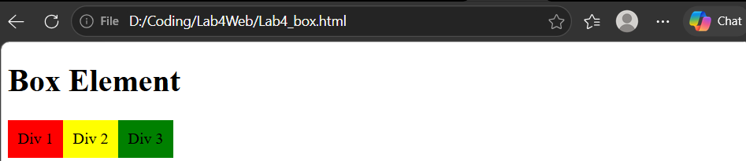
# Menggunakan Property CLEAR
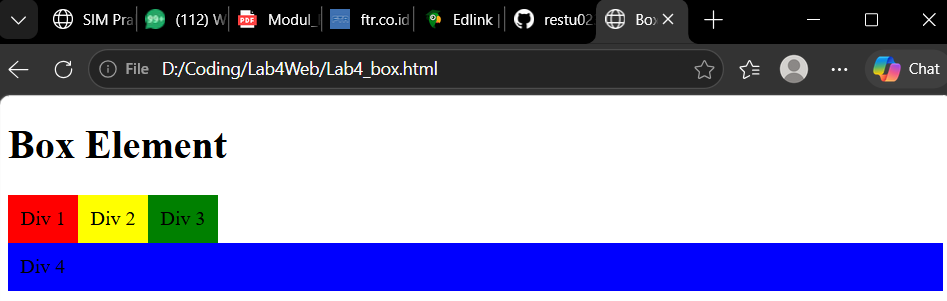
# Membuat dasar Layout 
Dasar Layout yang berisi bagian Home Artikel About dan Kontak
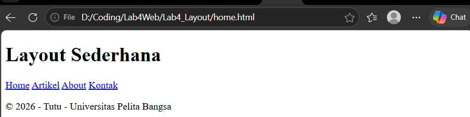
# Menambahkan kode CSS untuk membentuk tampilan awal layout
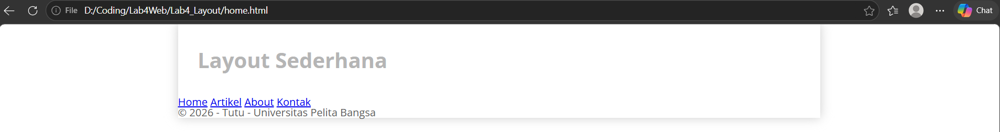

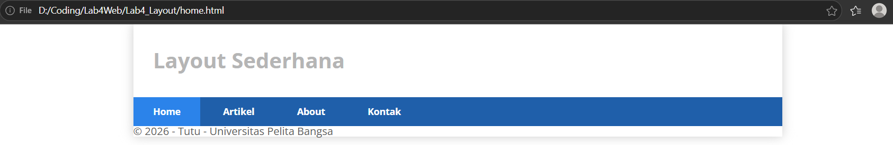
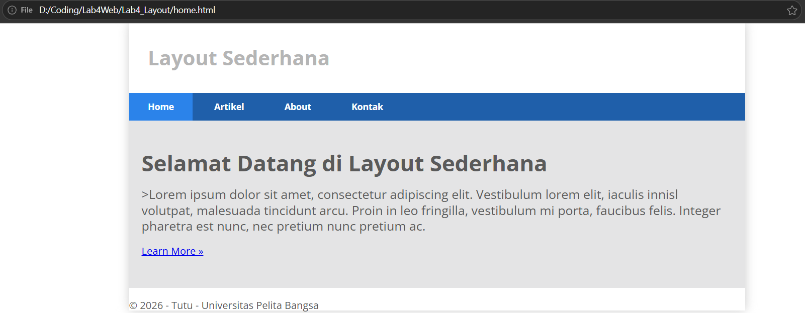
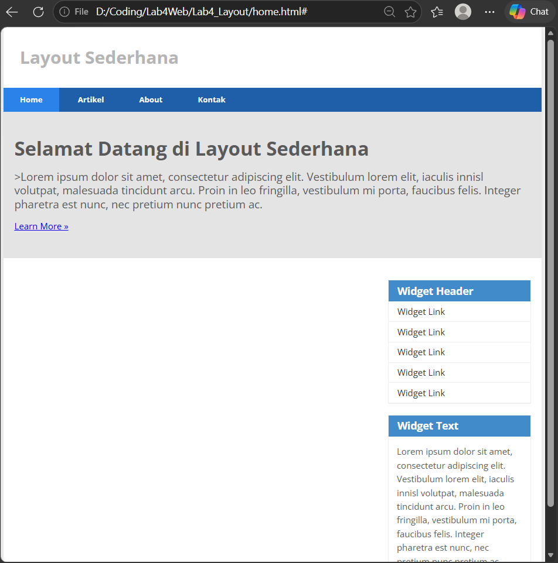
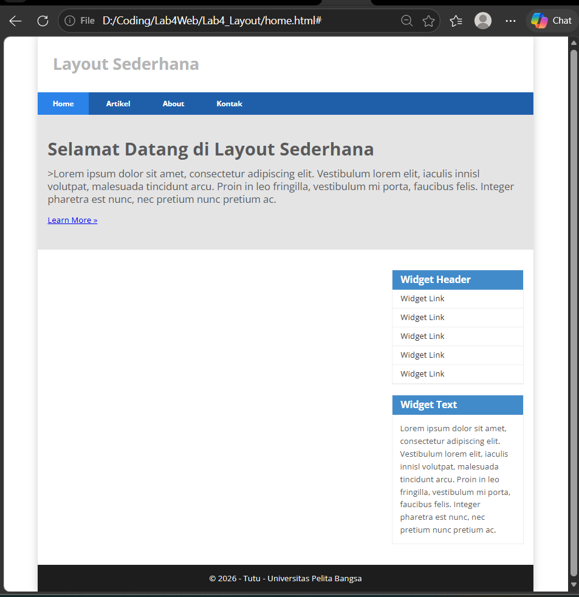
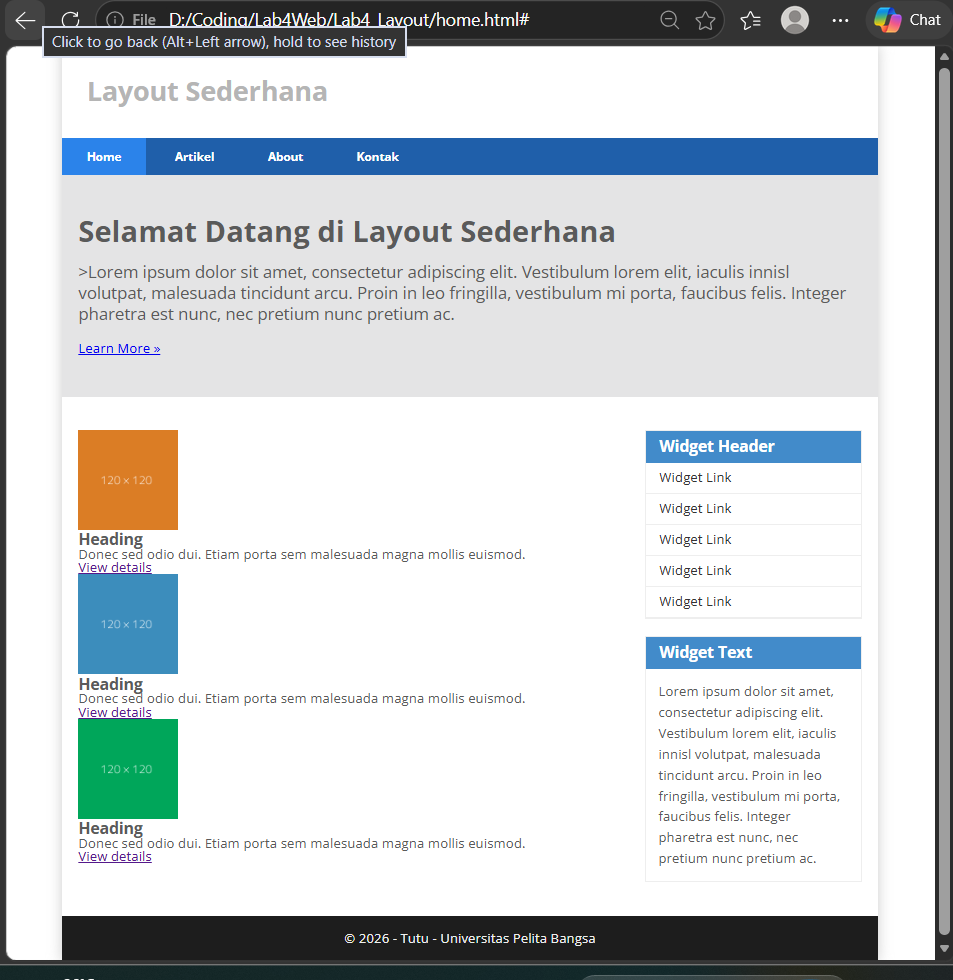
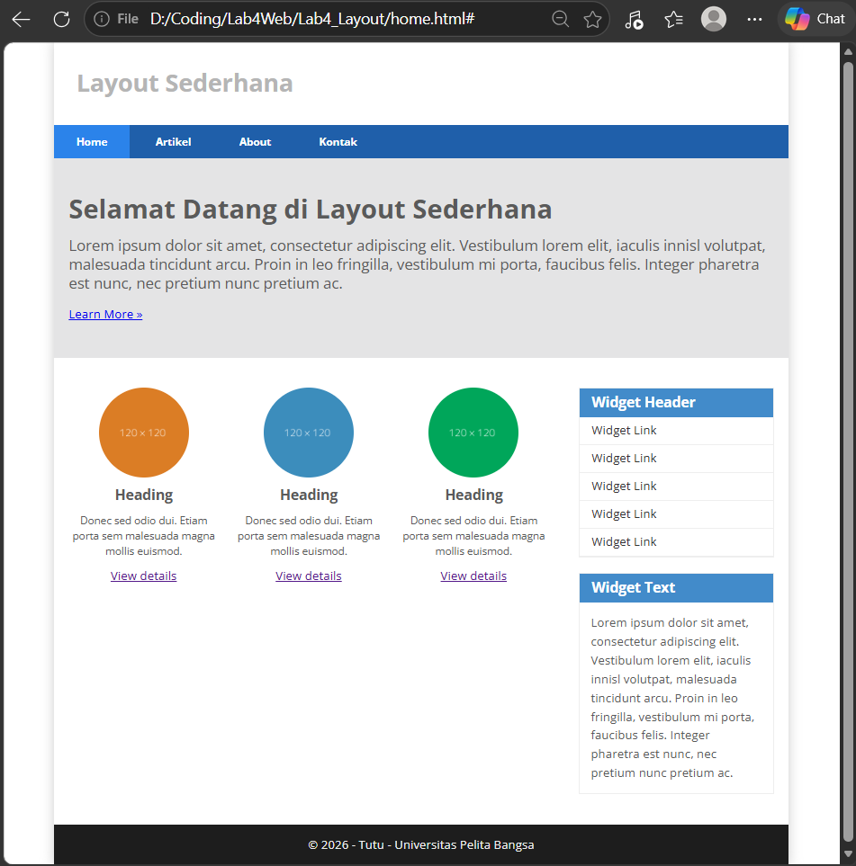
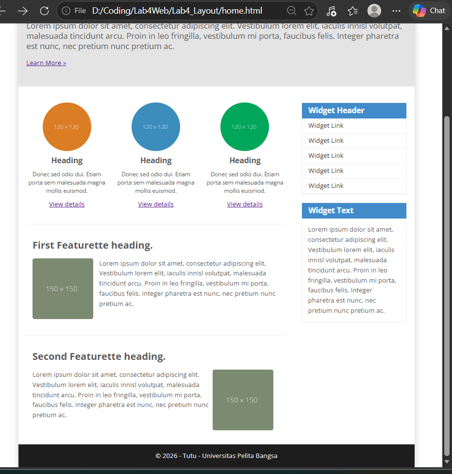
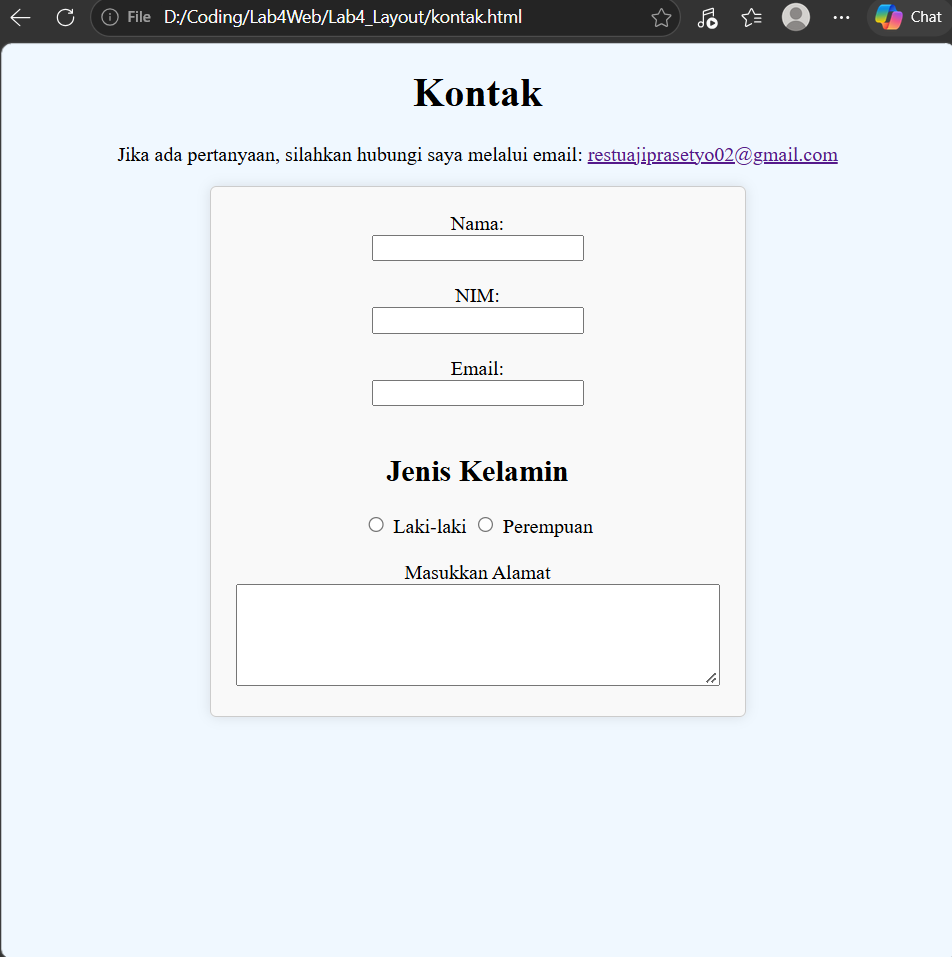
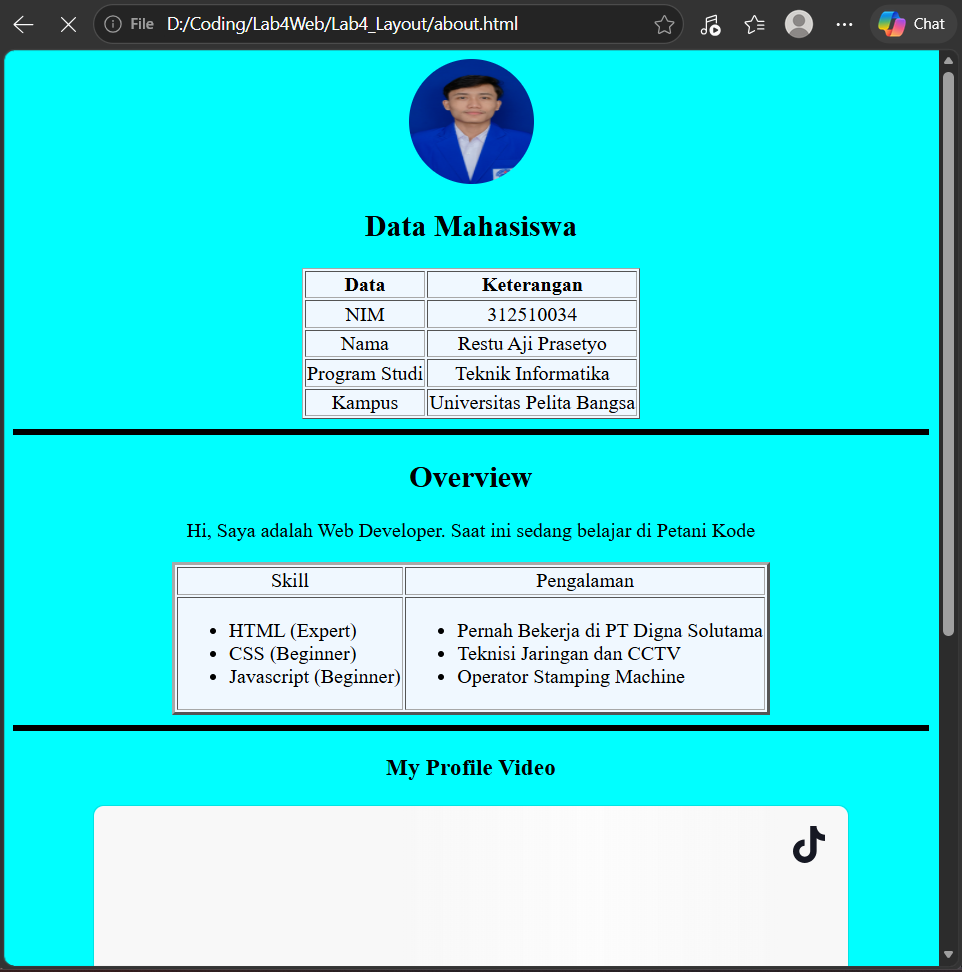